# Ghost Hunt · Who Else Was There?

**Every face in this video has a heartbeat. Except one.**

Most camera-vitals apps measure the pulse that is there. Ghost Hunt is a cute, spooky game that hunts for the pulse that is **missing**. It runs on the [Presage SmartSpectra SDK](https://smartspectra.presagetech.com/docs), which reads a person's pulse and breathing from an ordinary camera.

Entry for the DEV Presage SmartSpectra SDK Challenge, category **Most Creative or Delightful Use**.

[](https://github.com/jenniferevangelista-de/who-else-was-there/actions/workflows/ci.yml)

**Contents:** [The game in one minute](#the-game-in-one-minute) · [Everything you can do](#everything-you-can-do) · [The challenge's questions, answered](#the-challenges-questions-answered) · [How the SDK is used](#how-the-sdk-is-used) · [How we tested it](#how-we-tested-it) · [Run it yourself](#run-it-yourself) · [Consent and data](#consent-and-data-handling)

## The game in one minute

1. **A case arrives.** Marina was about to go out when a feeling at the door made her stay. She lives alone and saw nothing, but her hallway camera was on.
2. **Three tiny ghost hunters read the tape** with a new instrument, the Ghost Detector. Living faces have a heartbeat. A face with no heartbeat is the case.
3. **You ask the spirit.** The glass on the spirit board moves only when **you** breathe out, read from your camera.
4. **Then it is your turn.** The detector reads you, live, or a video you upload, and gives you a report with a verdict.

> **What is real and what is story.** Marina's case is a drawn story, and every screen in it is tagged *sample data*. The Room and "Bring your own video" run through the real SDK, and their numbers are real readings. Without a Presage key the whole app still opens, on samples.

## Everything you can do

### 1. Meet the crew
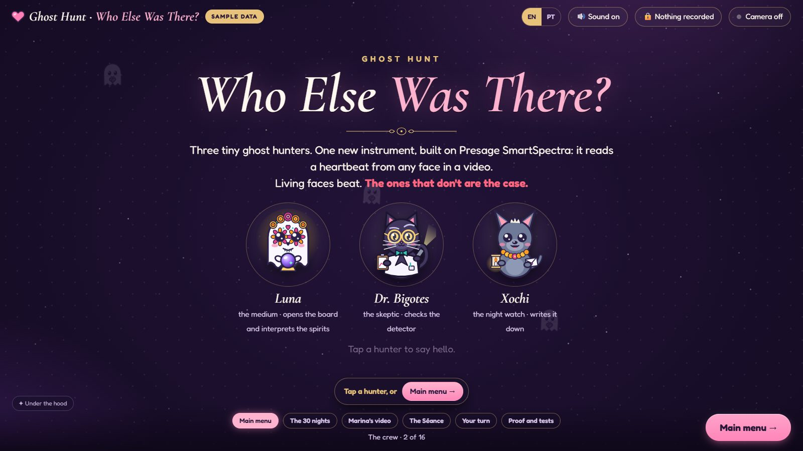

**Luna** is the medium: she opens the board and deciphers what the spirit wants. **Dr. Bigotes** is the skeptic: he checks the detector and refuses to sign anything he cannot measure. **Xochi** is the night watch: she writes it all down. The app speaks English and Portuguese, with its own voices and original music.

### 2. Thirty nights of tape
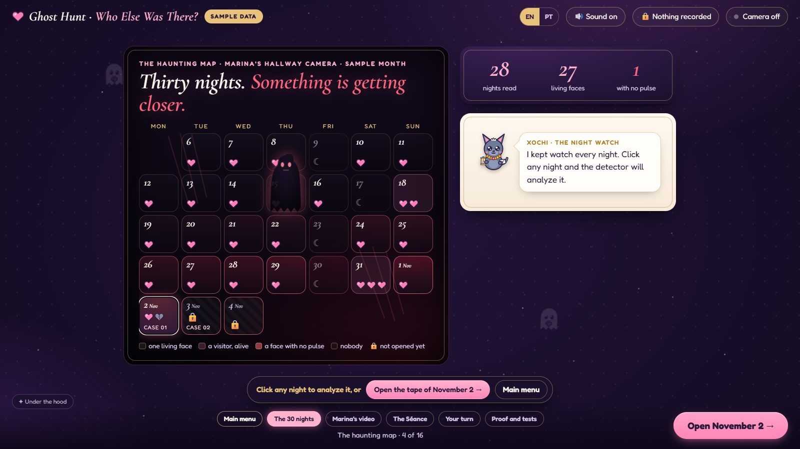

A month of Marina's hallway camera. Click any night and the detector analyzes it. Hearts show who was there, and the marks get closer to her door.

### 3. Analyze the tape
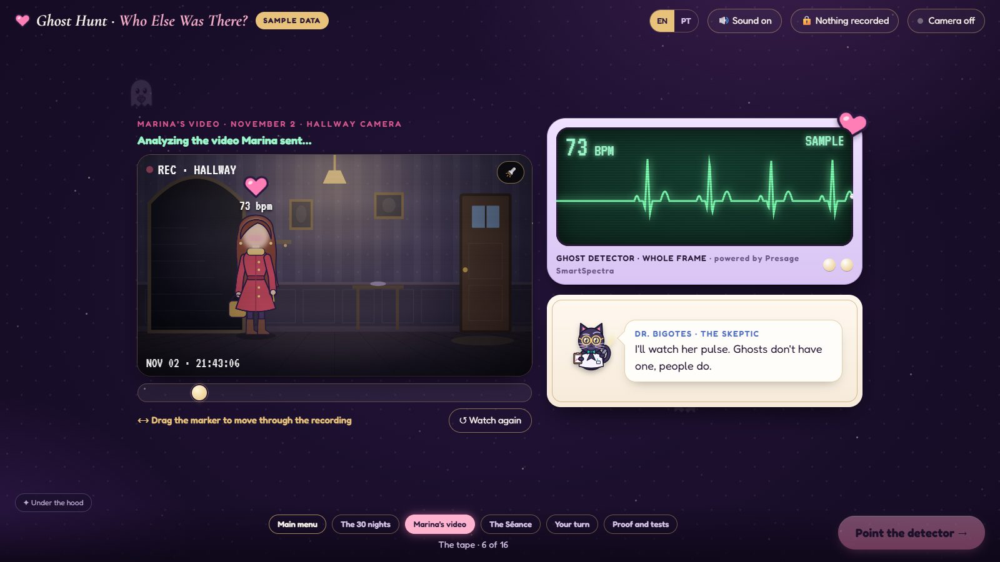

The tape plays while the detector reads the whole picture, with a live pulse line on the right. Drag the marker to any second, or turn on the flashlight and search the dark hallway with your mouse.

### 4. Point the detector at one spot
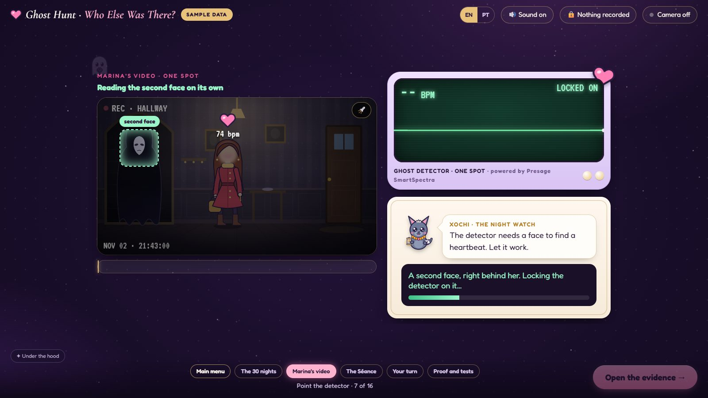

The detector finds the second face on its own and locks on. A living face shows a pulse. This one reads 0 beats per minute.

### 5. Open the evidence locker
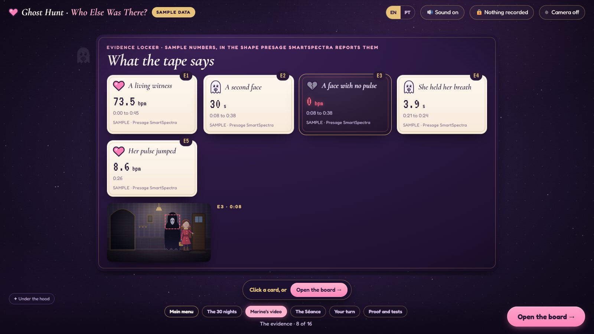

Each finding becomes a numbered card, such as a second face, a held breath or a pulse jump. Click a card to jump to that moment on the tape.

### 6. Ask the spirit
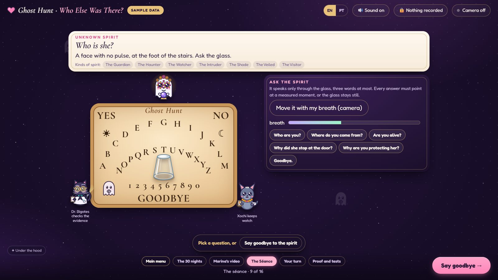

Pick a question and breathe out to move the glass. If you start talking, it waits. The spirit's file fills in as it answers: its name, its past, and what kind of spirit it is. Luna deciphers what it wants, and Dr. Bigotes refuses to sign it.

The kind is picked from the evidence, never at random:

| Kind of spirit | What the detector found |
|---|---|
| **The Guardian** | A face with no pulse, and a living person who held her breath |
| **The Haunter** | A face with no pulse, and a living pulse that jumped beside it |
| **The Watcher** | A face with no pulse, and nothing else |
| **The Intruder** | A second face with a pulse. Not a spirit at all: someone alive |
| **The Shade** | A shape with no face to read |
| **The Veiled** | Something too dark for the detector to read |
| **The Visitor** | A second face the detector could not place |

### 7. Read Xochi's dossier
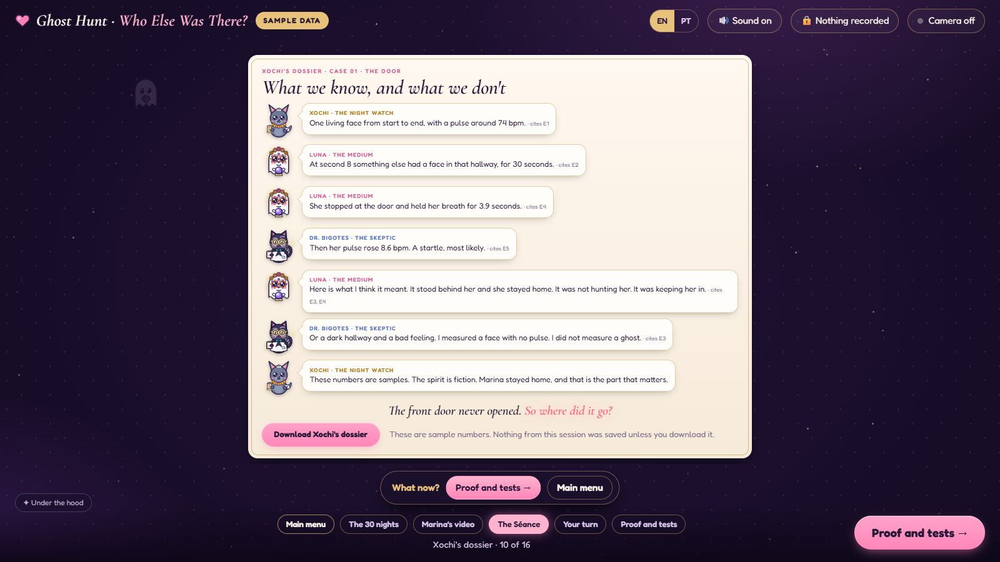

What the crew knows and what it does not, with every sentence citing an evidence card. You can download it. It contains words and numbers only.

### 8. The Room: the detector reads you, live
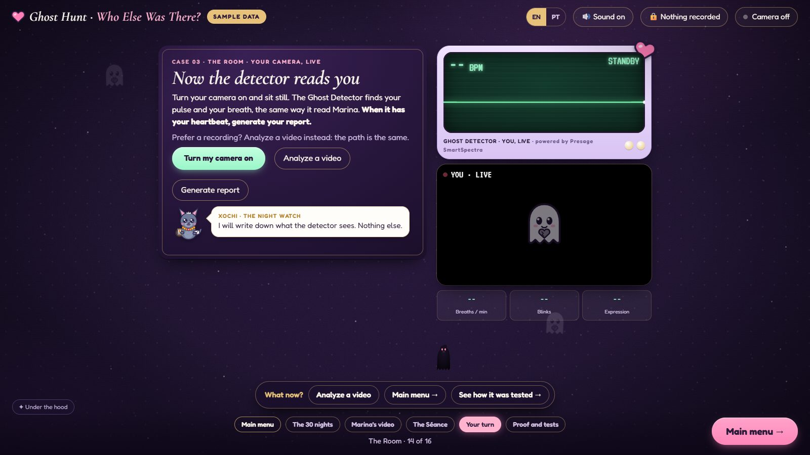

Turn your camera on and your real pulse, breathing and expression appear on the detector. A figure in the room moves only when you blink. Your own readings become evidence cards as they arrive.

### 9. Bring your own video
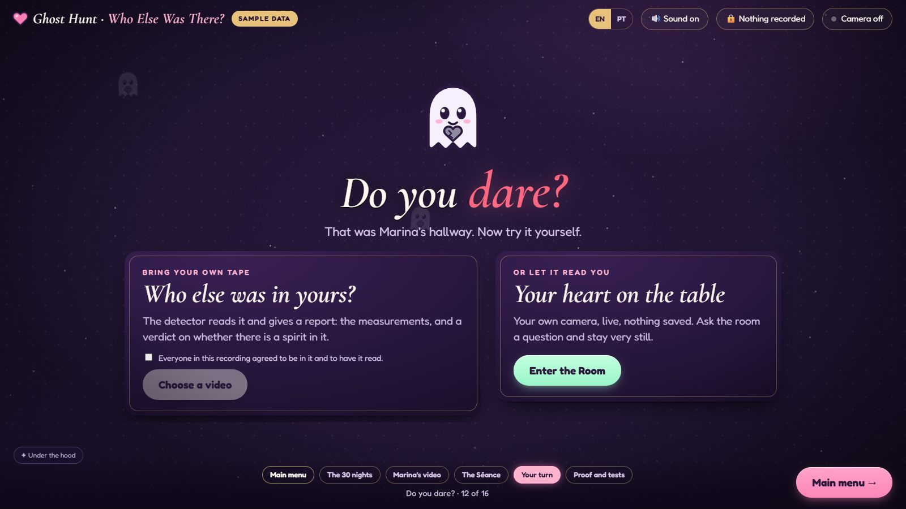

Upload a recording. The button stays locked until you confirm that everyone in it agreed. The SDK reads the video as it plays, and you get the same report.

### 10. Your report, with a verdict
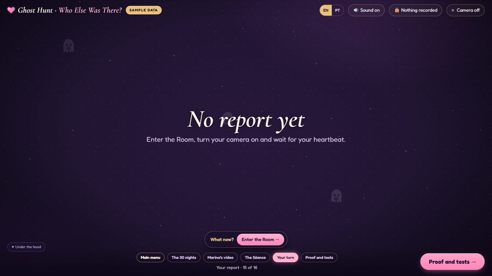

The stamp at the top is the verdict: is there a spirit in this video? Below it are your numbers, your pulse over time and what happened when. The picture above uses sample numbers and says so. Nothing is saved unless you press Save.

### 11. Proof and tests
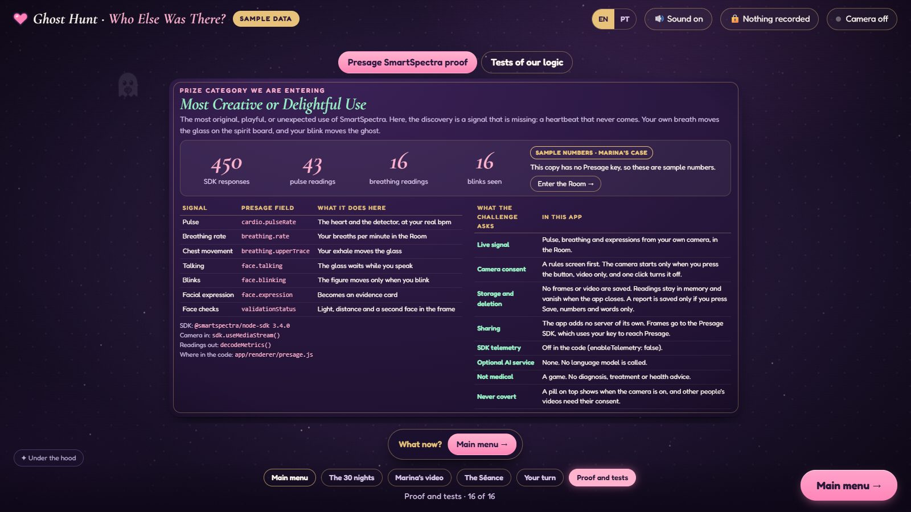

A tab inside the app counts the SDK's responses as they arrive and lists each signal and where it is in the code. A second tab shows how our rules were tested.

## The challenge's questions, answered

| The challenge asks | Short answer | Read more |
|---|---|---|
| What does it let people do? | Solve a ghost case from a pulse that is missing, talk to a spirit with their breath, then get read themselves, live or from a video. | [Everything you can do](#everything-you-can-do) |
| Is it a working app on the SDK? | Yes. An Electron desktop app on `@smartspectra/node-sdk` 3.4.0. | [`app/renderer/presage.js`](app/renderer/presage.js) |
| Does it use a live Presage signal? | Seven of them, live in The Room. | [How the SDK is used](#how-the-sdk-is-used) |
| How does it respond in real time? | The heart and detector follow your pulse, your exhale moves the glass, talking makes it wait, and your blink moves the figure. | [How the SDK is used](#how-the-sdk-is-used) |
| How is camera consent obtained? | A rules screen comes first. The camera starts only on a button press and turns off in one click. | [Consent](#consent-and-data-handling) |
| What about storage, sharing, retention and deletion? | No frame is saved and no video is recorded. Readings live in memory and vanish when the app closes. | [Consent](#consent-and-data-handling) |
| SDK telemetry and AI services? | Telemetry is off in the code. There is no AI service and no language model. | [Consent](#consent-and-data-handling) |
| Is login needed? | No. Without a key the app opens on sample data. | [Run it yourself](#run-it-yourself) |
| Any medical claims? | None. It is a game and says so on screen. | [Consent](#consent-and-data-handling) |
| Any covert monitoring? | No. Other people's videos stay locked until you confirm they agreed. | [Consent](#consent-and-data-handling) |
| Which prize category? | Most Creative or Delightful Use. | |

**How it meets the judging criteria**

- **Use of the technology:** seven SDK signals, each changing what happens on screen, and a detector that treats a *missing* signal as the discovery.
- **Usability and experience:** a guided story, one clear next step on every screen, two languages, and a full sample mode when there is no key.
- **Originality:** the absence of a pulse is the plot, your breath is the controller, and the spirit is not allowed to say anything it cannot cite.

## How the SDK is used

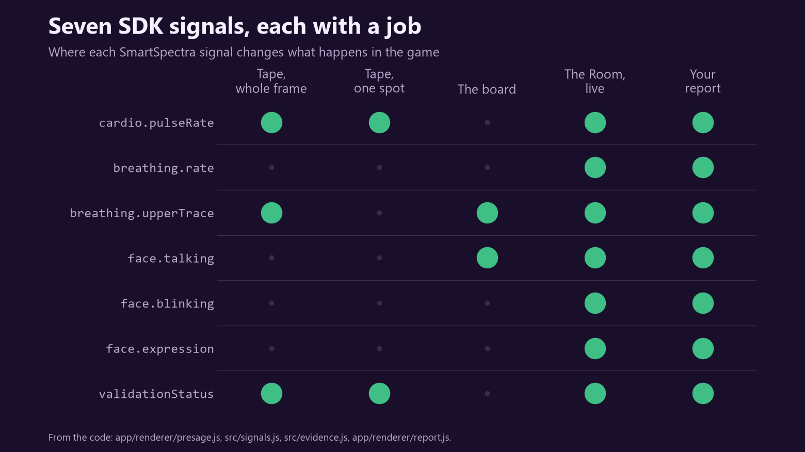

**How to read this picture.** Each row is a signal the SDK gives us. Each column is a part of the game. A big green dot means that signal changes something on that screen. **What it tells you:** all seven signals are in use, and none is there just for show.

| Signal | SDK field | What the game does with it |
|---|---|---|
| Pulse | `cardio.pulseRate` with confidence | Drives the heart and the detector line. Readings under 50% confidence do not count. |
| Breathing rate | `breathing.rate` | Your breaths per minute in the Room and in your report. |
| Chest movement | `breathing.upperTrace` | Moves the glass on the exhale. A flat stretch of 3 s or more becomes "held breath". |
| Talking | `face.talking` | The glass waits while you speak. |
| Blinks | `face.blinking` | The figure in the Room moves only when you blink. |
| Expression | `face.expression` | Your strongest stable expression becomes an evidence card. |
| Face checks | `validationStatus` | Multiple faces becomes "a second face". Poor light turns a verdict into "unreadable". |

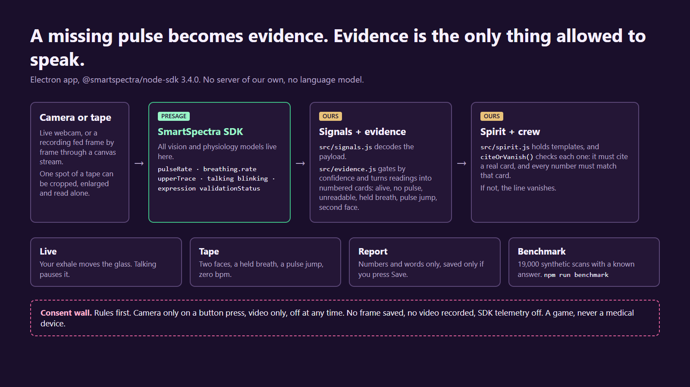

**How to read this picture.** Follow the top row from left to right. The camera or video goes into Presage's SDK (green). Our code (gold) turns its numbers into evidence cards. Only then can the spirit speak. The second row shows what comes out, and the dashed box is the consent rule around all of it.

**Cite or vanish.** There is no language model. Every line the spirit says is a template that must cite a real evidence card, and every number in it must match that card. If not, the line is not said. The rule is `citeOrVanish()` in [`src/evidence.js`](src/evidence.js).

## How we tested it

**The computer vision belongs to Presage.** Reading a pulse from pixels is what the SDK does, so we treat it as an instrument. We trained no model of our own, and the app makes 0 language model calls. What is ours is the logic that decides what the numbers mean, so that is what we tested.

**How the test works.** It is like hiding a fake ghost to see if the detector finds it. We generate fake sensor data where we already know the answer, for example "this one has a 4-second held breath", and check whether the rules get it right. We did this **19,000 times**. Anyone can repeat it with `npm run benchmark` and get the same numbers. These tests check our game rules, not Presage's accuracy, and no real person is in them.

### Does it get the basic answer right?

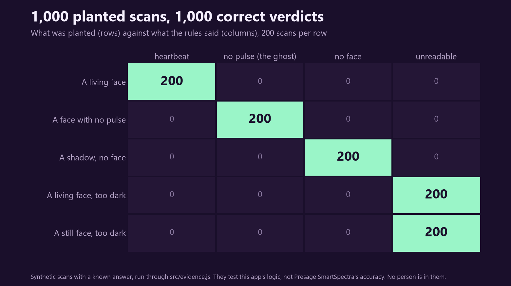

**How to read this picture.** The left side is what we hid in the test. The top is what the detector answered. A number in a green box on the diagonal means right answers, and any number off the diagonal would be a mistake. **What it tells you:** 1,000 right out of 1,000. Most importantly, **a living face was called a ghost 0 times in 400**, even in the dark.

### How long must you hold your breath to be noticed?

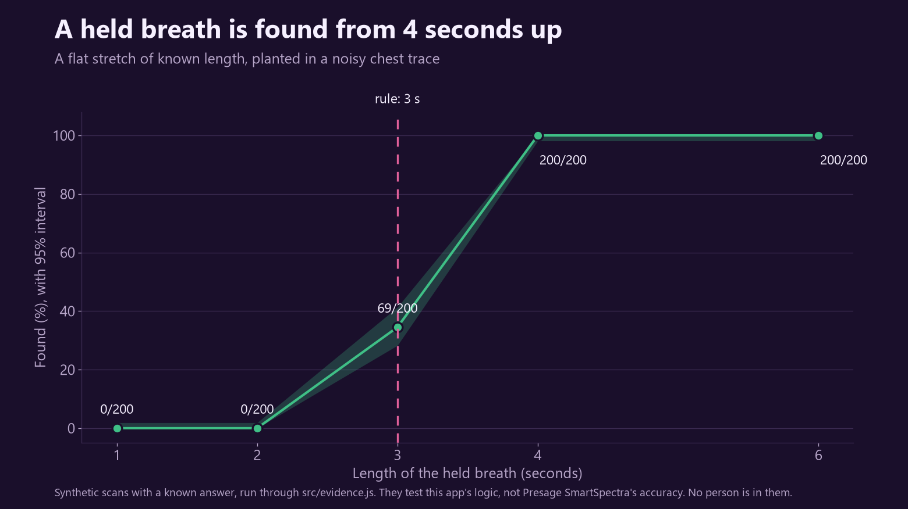

**How to read this picture.** Left to right is how long the breath was held. Higher means noticed more often. The pink dashed line is where the rule starts. **What it tells you:** 1 or 2 seconds never set it off, so normal pauses are ignored. From 4 seconds it notices every time. Exactly 3 seconds is the borderline.

### How big must a pulse jump be?

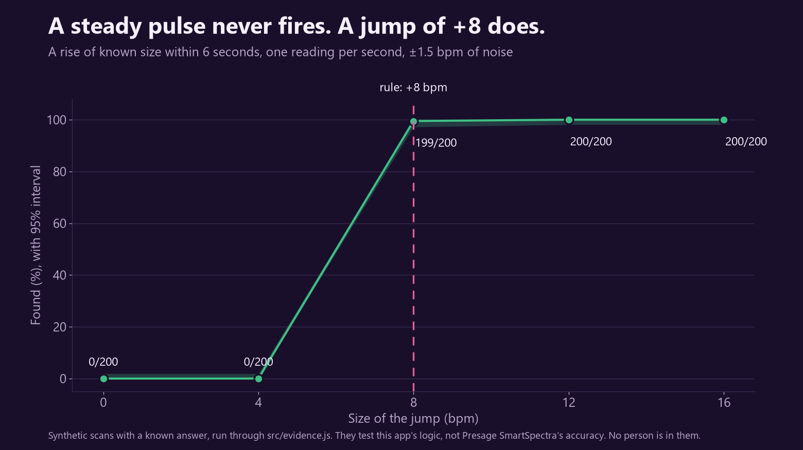

**How to read this picture.** Same as above, with the size of the heart-rate jump. **What it tells you:** a steady heart never triggers it (0 of 200), and a jump of 8 beats per minute does (199 of 200).

### Where do our rules fail?

A test that only shows wins proves little, so we pushed the noise up until the rules broke. In these two pictures, **each number is how many of 200 tests got the right answer. Green is right, pink is wrong.**

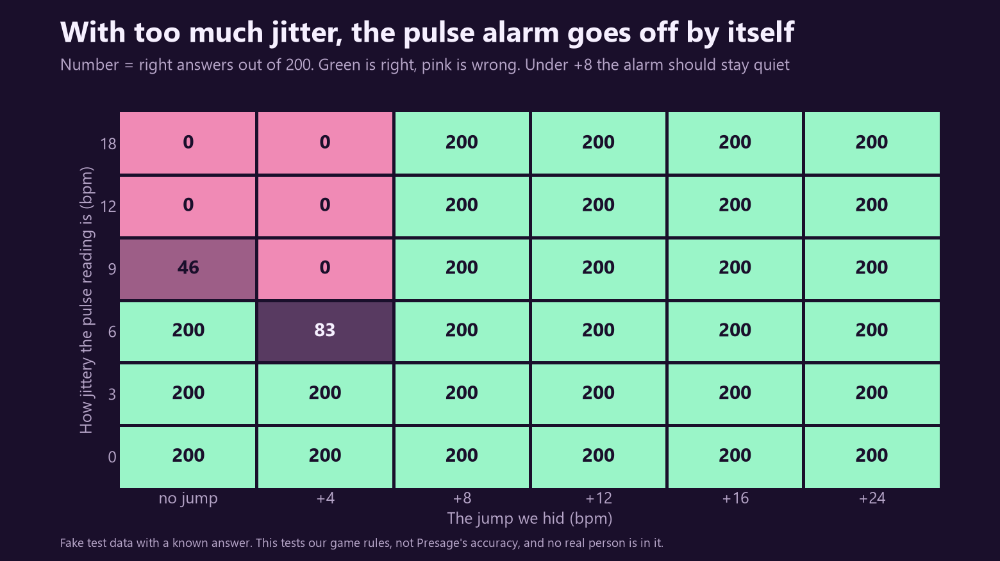

**How to read this picture.** Going up, the pulse reading gets more jittery. Going right, the jump we hid gets bigger. **What it tells you:** real jumps are always caught (all green on the right). But in the left columns, where the alarm should stay quiet, too much jitter sets it off by itself. It holds up to 6 bpm of jitter and fails from 9.

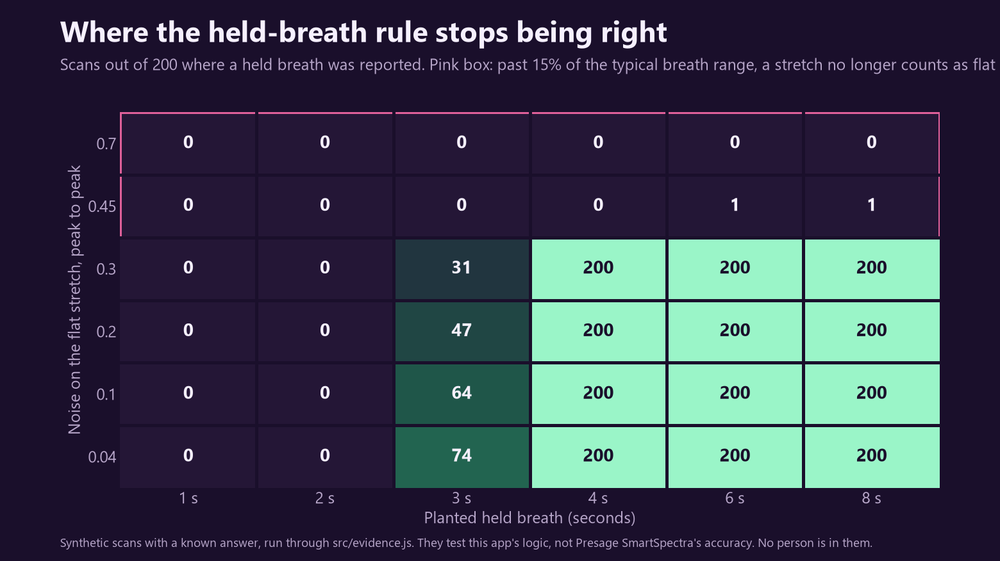

**How to read this picture.** Going up, the chest signal gets shakier during the held breath. Going right, the breath is held longer. **What it tells you:** when the chest looks too shaky (0.45 and above), the game no longer counts it as a held breath, so real ones are missed. It chooses to miss one rather than invent one. The 3-second column is exactly on the rule's line, so it can go either way.

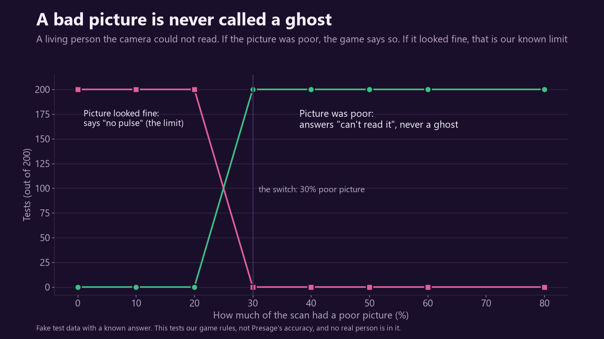

**How to read this picture.** This is a living person the camera could not read. Going right, more of the scan had a poor picture. **What it tells you:** past 30% poor picture, the game says it cannot read the face, and never calls it a ghost. On the left, the picture looked fine and the pulse still could not be read, so the game says "no pulse". That is our honest limit.

**Known limits, stated plainly**

- A held breath of exactly 3 seconds is noticed only 31 to 74 times in 200, depending on noise. It is reliable from 4 seconds.
- With 9 bpm or more of jitter in the reading, the pulse-jump alarm goes off by itself (154 of 200 at 9 bpm, 200 of 200 from 12 bpm).
- A living person whose pulse cannot be read in a good picture is called "no pulse". That is the honest limit of reading absence, and one reason this is a game and never a health tool.
- Marina's tape is drawn. The SDK has been run here on a live camera and on a recording with no people in it, and has not been benchmarked on portraits or masks.

## Run it yourself

Works on Windows, macOS Apple Silicon and Linux x64. You need Node.js 22.12 or newer. Live readings need a Presage API key from [physiology.presagetech.com](https://physiology.presagetech.com).

```bash
git clone https://github.com/jenniferevangelista-de/who-else-was-there
cd who-else-was-there
npm install
npm start
```

**Without a key** the app opens in replay mode: sample numbers, no camera, every screen visible. No login is needed.

**With a key**, set `PRESAGE_API_KEY` in your environment before `npm start`. Then open **The Room** to read your camera, or **Bring your own video** to read a recording. The key is read from the environment by the main process and is never written to disk.

```bash
npm test                         # 36 unit tests
npm run benchmark                # writes demo/measured.json
python scripts/make_charts.py    # redraws every chart from it (needs matplotlib)
```

## Consent and Data Handling

- **Camera consent:** the rules are shown before the hunt. The camera turns on only when you press a button, and the pill at the top right turns it off at any time. Video only; the microphone is never requested.
- **Tapes you bring:** the file picker stays locked until you confirm that everyone in the recording agreed to be in it and to have it read.
- **Storage and retention:** the app saves no frames and records no video. Readings live in memory and vanish when the app closes. A dossier or session report is written only if you press Download or Save; each holds numbers and words, no images.
- **Display:** the live preview appears only on the screen of the person in front of the camera.
- **Sharing:** the app sends nothing to any server of its own, and it has none.
- **The SDK:** frames are handed to Presage SmartSpectra inside the app, which is initialised with your API key and uses Presage's authenticated channel. Presage's public documentation does not say where frames are processed, so this project does not claim on-device processing. See Presage's [Telemetry and Privacy](https://smartspectra.presagetech.com/docs/telemetry-and-privacy) page and Privacy Policy for the SDK's own requests and retention.
- **SDK telemetry:** switched off (`enableTelemetry: false`). By Presage's documentation that aggregate telemetry excludes frames and measured values.
- **Deletion:** close the app and the readings are gone. Delete a downloaded dossier like any file.
- **AI services:** none at run time. The spirit's answers are templates that must cite measured evidence.
- This is a game, not a medical device. It does not diagnose, treat or monitor anyone.

## Credits

Characters Luna, Dr. Bigotes and Xochi come from [Witching Hour](https://github.com/jenniferevangelista-de/witching-hour) by the same author. Fonts: Fredoka, Cormorant Garamond, VT323 (SIL Open Font License). MIT licensed.
