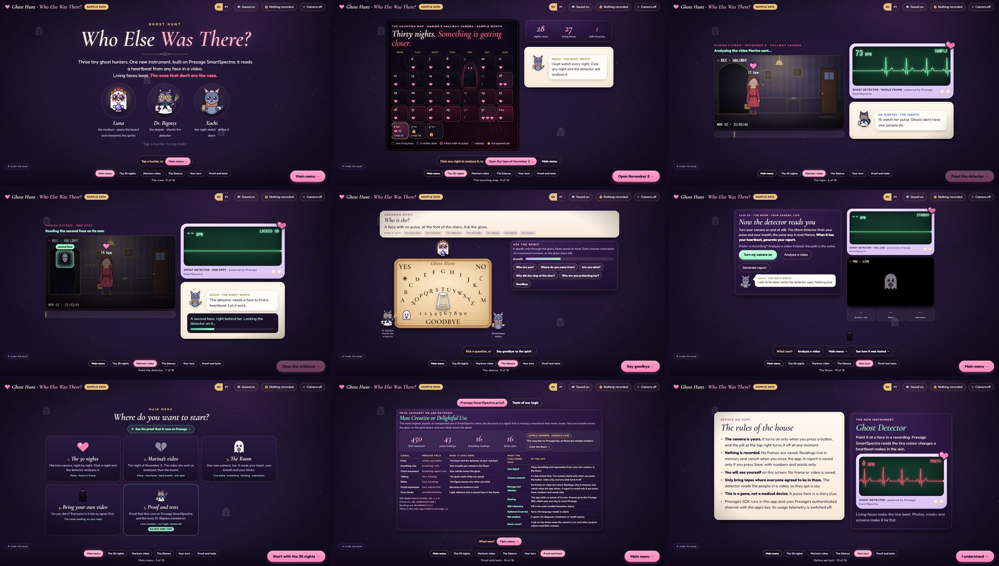

# Ghost Hunt: Who Else Was There?

**Every face in this video has a heartbeat. Except one.**

A cute, spooky ghost hunt built on the [Presage SmartSpectra SDK](https://smartspectra.presagetech.com/docs). A client was about to go out, everything was fine, and a feeling at the door made her stay. She never saw what stood behind her. The crew's new instrument, the Ghost Detector, reads a pulse from every face in her hallway tape. Living faces beat. The face that does not is the case. Then the spirit answers on a board that only moves when **you** breathe out, and the crew never agrees on what it meant.

[](https://github.com/jenniferevangelista-de/who-else-was-there/actions/workflows/ci.yml)

> Work in progress for the DEV Presage SmartSpectra SDK Challenge. The screens below run on **sample numbers** until the staged tape is measured.



## How it uses Presage SmartSpectra

| Where | Signal | What the story does with it |
|---|---|---|
| The tape, whole frame | pulse rate, validation status | a living witness; **"multiple faces"** from the SDK becomes *a second face* |
| The tape, one spot | pulse rate on a cropped, enlarged region | a face with **no pulse** (a portrait, a mask, a screen) is the ghost |
| The tape | chest trace (`breathing.upperTrace`) | *she held her breath* |
| The séance, your camera, **live** | chest trace, talking | the glass moves only when you breathe out, and waits while you talk |
| The Room, your camera, **live** | pulse rate, chest trace | your own evidence cards; if your pulse jumps right after the glass stops, the lights go out |

## Run it yourself (Windows, macOS Apple Silicon, Linux x64)

You need Node.js 22.12 or newer and, for live readings, a Presage API key from [physiology.presagetech.com](https://physiology.presagetech.com).

```bash
git clone https://github.com/jenniferevangelista-de/who-else-was-there
cd who-else-was-there
npm install
npm start
```

Without a key the app opens in **replay mode** (sample numbers, no camera). With `PRESAGE_API_KEY` set in your environment it reads your camera live in the séance, and reads any tape you bring on the case screen. The key is read from the environment by the main process and is never written to disk.

## Consent and Data Handling

- **Camera consent:** the rules are shown before the hunt. The camera turns on only when you press a button, and the pill at the top right turns it off at any time. Video only; the microphone is never requested.
- **Tapes you bring:** the file picker stays locked until you confirm that everyone in the recording agreed to be in it and to have it read.
- **Storage and retention:** the app saves no frames and records no video. Readings live in memory and vanish when the app closes. A dossier file is written only if you press Download; it holds numbers and words, no images.
- **Display:** faces of the living are blurred on every screen.
- **Sharing:** the app sends nothing to any server of its own, and it has none.
- **The SDK:** Presage SmartSpectra is initialised with your API key and uses Presage's authenticated channel. Its aggregate diagnostic telemetry, which by Presage's documentation excludes frames and measured values, is switched off (`enableTelemetry: false`). See Presage's [Telemetry and Privacy](https://smartspectra.presagetech.com/docs/telemetry-and-privacy) page and Privacy Policy for the SDK's own requests and retention.
- **Deletion:** close the app and the readings are gone. Delete a downloaded dossier like any file.
- No language model is used: the spirit's answers are templates that must cite measured evidence ("cite or vanish").
- This is a game, not a medical device. It does not diagnose, treat or monitor anyone.

## Credits

Characters Luna, Dr. Bigotes and Xochi come from [Witching Hour](https://github.com/jenniferevangelista-de/witching-hour) by the same author. Fonts: Fredoka, Cormorant Garamond, VT323 (SIL Open Font License). MIT licensed.
