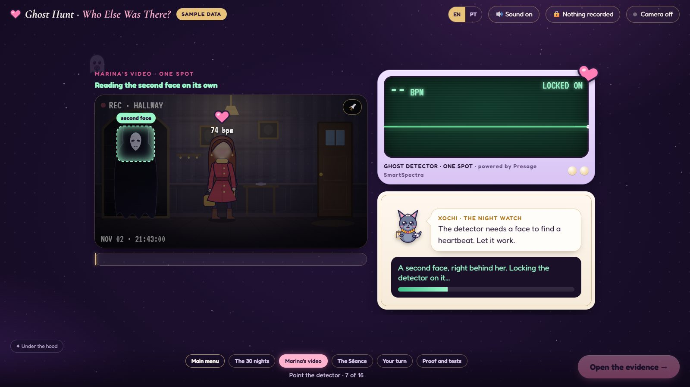
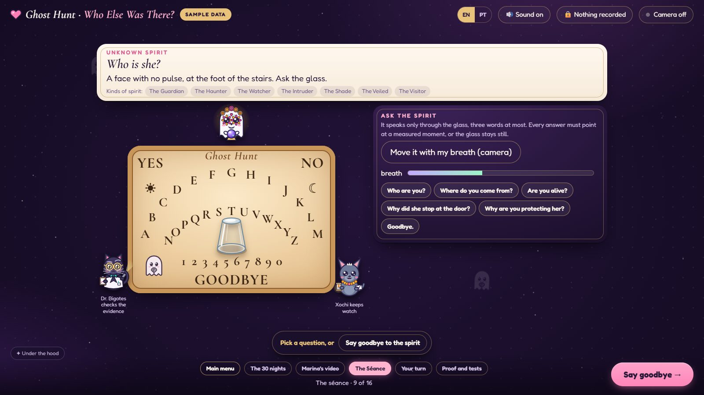
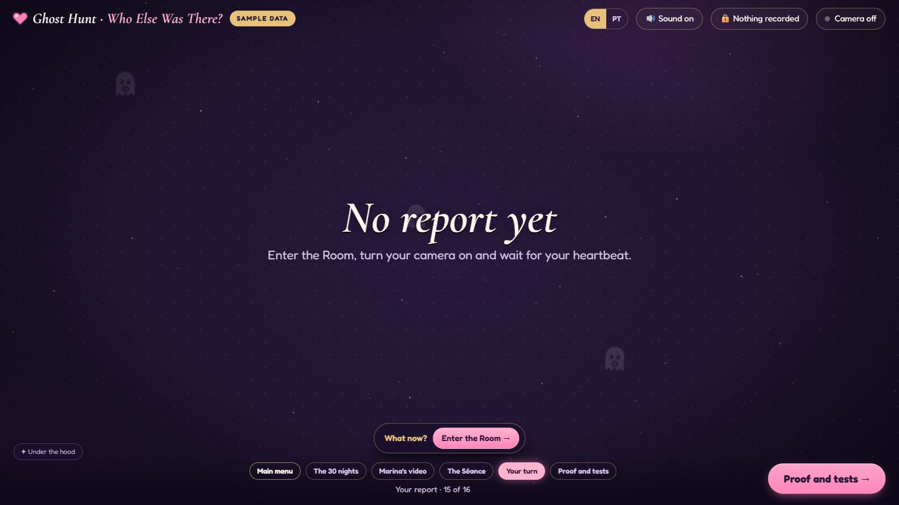
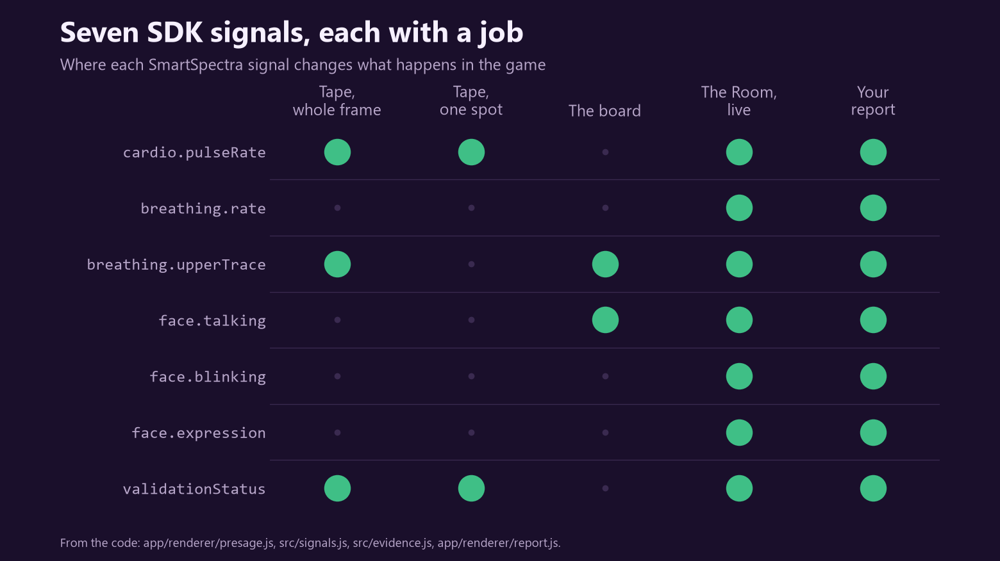
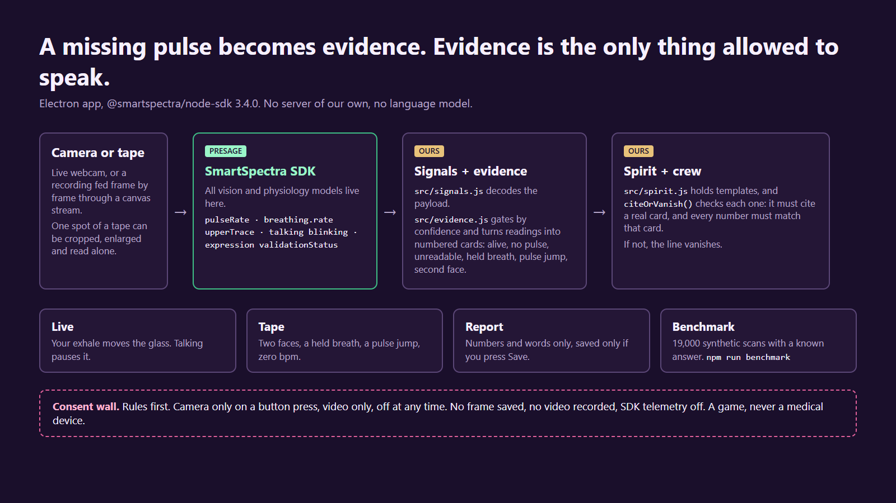
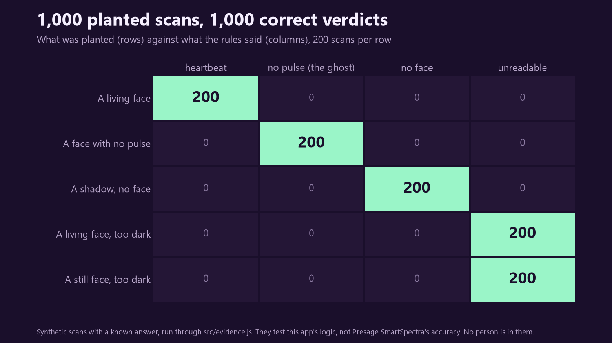
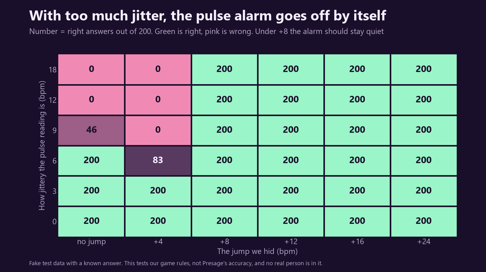

*This is a submission for the [Presage SmartSpectra SDK Challenge](https://dev.to/devteam/join-the-presage-smartspectra-sdk-challenge-3000-in-prizes-across-10-winners-1370).*

| | |
| --- | --- |
| **Signals** | 7 live Presage SmartSpectra signals: pulse, chest movement, breathing rate, talking, blinks, expression, validation status |
| **Platform** | Electron desktop app, English and Portuguese |
| **Privacy** | Camera only after consent, no frames saved, no video recorded, SDK telemetry off |
| **Tested** | 19,000 tests on fake data with a known answer |
| **Play it now** | [Web demo in your browser](https://jenniferevangelista-de.github.io/who-else-was-there/), on sample numbers. The live camera reading runs in the desktop app, because the Presage SDK is native (Node.js/Electron) |
| **Code** | [github.com/jenniferevangelista-de/who-else-was-there](https://github.com/jenniferevangelista-de/who-else-was-there) (MIT) |

## What I Built

Most camera-vitals apps measure the pulse that is there. **Ghost Hunt** is a cute, spooky game that hunts for the pulse that is **missing**.

Plenty of people would play it for real. In a 2009 Pew Research Center survey, **18% of U.S. adults** said they had seen a ghost or been in the presence of one, and **29%** said they had felt in touch with someone who had already died ([Pew Research Center](https://www.pewresearch.org/short-reads/2015/10/30/18-of-americans-say-theyve-seen-a-ghost/)). Ghost Hunt gives that feeling an instrument, and a rule: nothing counts unless the camera measured it.

Marina was about to go out. At the door, a feeling hit her so hard she couldn't breathe, and she stayed home. She lives alone and saw nothing, but the hallway camera was on. Three tiny ghost hunters point a new instrument at her tape, the Ghost Detector. Living faces have a heartbeat. The face that does not is the case.

| Point | Ask | Report |
| --- | --- | --- |
|  |  |  |

**What you can do in it**

- **Browse 30 nights of tape** on a haunted calendar, and let the detector analyze any night.
- **Analyze the tape:** drag to any second, or search the hallway with a flashlight.
- **Point the detector at one spot:** it finds the second face and locks on. 0 beats per minute.
- **Collect evidence cards** that jump to the exact moment on the tape.
- **Ask the spirit** on a board that moves only when **you** breathe out, and waits if you talk.
- **Learn what it is.** Each spirit gets one of seven kinds, picked from the evidence: Guardian, Haunter, Watcher, Intruder, Shade, Veiled or Visitor. Luna, the medium, deciphers what it wants. Dr. Bigotes, the skeptic, refuses to sign it. Xochi writes it all down.
- **Get read yourself in The Room:** your real pulse, breathing and expression, live from your camera. A figure moves only when you blink.
- **Upload your own video,** once you confirm everyone in it agreed. Presage reads it as it plays, and you get a report with a verdict: is there a spirit in it?

It is a desktop app in Electron, in English and Portuguese, with original music and voices. Marina's story is drawn and tagged as sample data on every screen. The Room and uploaded videos are real SDK readings.

## Demo

**Demo, with the live signal:**



**Pitch:**



**Play it in your browser, no install:** https://jenniferevangelista-de.github.io/who-else-was-there/ (sample numbers).

No login is needed. Without a Presage key the app opens on sample numbers, and every sample screen is tagged. With a key, The Room reads your camera live.

## Code



Setup is in the README, along with a walkthrough of every screen. The SDK integration is in `app/renderer/presage.js`.

## How It Responds to Human Signals

Seven SmartSpectra signals, and each one has a job in the game.

*How to read it: each row is a signal, each column is a part of the game, and a big green dot means that signal changes something on that screen.*

- **Pulse** (`cardio.pulseRate`) drives the heart and the detector line, in real time. Readings under 50% confidence do not count.
- **Chest movement** (`breathing.upperTrace`) moves the séance glass when you breathe out, and finds a held breath.
- **Talking** (`face.talking`) makes the glass wait while you speak.
- **Blinks** (`face.blinking`) are the only thing that moves the figure in the Room.
- **Breathing rate** (`breathing.rate`) and **expression** (`face.expression`) become your numbers and your evidence cards.
- **Validation status** (`validationStatus`) turns "multiple faces" into *a second face*, and poor light into "unreadable". A badly lit face is never called a ghost.

One rule keeps the spirit honest: **cite or vanish**. There is no language model. Every line the spirit says must cite a measured card, and every number in it must match that card, or the line is not said.

*How to read it: follow the top row from left to right. The camera goes into Presage's SDK, our code turns its numbers into evidence cards, and only then can the spirit speak.*

### How I tested it, including where it breaks

The computer vision belongs to Presage, and I treat it as an instrument. What is mine is the logic that decides what the numbers mean, so I tested that. It works like hiding a fake ghost to see if the detector finds it: **19,000 tests on fake data where I already know the answer**, reproducible with `npm run benchmark`. They test my rules, not Presage's accuracy, and no real person is in them.

*How to read it: the left side is what I hid, the top is what the detector answered. Numbers on the green diagonal are right answers. Anything off it would be a mistake.*

A living face was called a ghost **0 times in 400**. Then I pushed the noise up until the rules failed, because that is the useful part.

*How to read it: each number is how many of 200 tests got the right answer. Green is right, pink is wrong. Going up, the reading gets more jittery. Real jumps are always caught, but from 9 bpm of jitter the alarm starts going off by itself.*

The README explains every chart and lists every limit I found.

## What the SDK Taught Me

1. **Confidence is part of the signal.** A pulse under 50% confidence does not count. Without that rule, a shaky reading looks exactly like a ghost.
2. **Bad light is not a spirit.** The SDK's validation status says when a face cannot be read, and the game turns that into "unreadable" instead of a scary verdict.
3. **The SDK wants a real device.** I tried a reading on a cloud server (GitHub Actions) and Presage refused to pair it (HTTP 403). The live readings in the demo come from a real computer with a camera.
4. **Windows can block it.** With Smart App Control on, Windows blocks the SDK's unsigned libraries. The app still opens on tagged sample numbers, so nobody gets a blank screen.

## Prize Categories

**Most Creative or Delightful Use.** The discovery here is a heartbeat that never comes, your own breath moves the glass on the board, and the blink is a jump scare with rules.

## Consent and Data Handling

- **Camera consent:** a rules screen comes first. The camera turns on only when you press a button, a pill at the top right turns it off at any time, and the microphone is never requested.
- **Other people's videos:** the file picker stays locked until you confirm that everyone in the recording agreed.
- **Storage and retention:** no frames saved and no video recorded. Readings live in memory and vanish when the app closes. A report is written only if you press Save, with numbers and words only.
- **Sharing:** the app has no server of its own and sends nothing to one.
- **The SDK:** frames are handed to Presage SmartSpectra inside the app, which uses your API key and Presage's authenticated channel. Presage's public documentation does not say where frames are processed, so I do not claim on-device processing. See Presage's Telemetry and Privacy page and Privacy Policy.
- **SDK telemetry:** switched off (`enableTelemetry: false`).
- **Deletion:** close the app and the readings are gone. Delete a saved report like any file.
- **AI services:** none at run time.
- **Not medical:** this is a game. It does not diagnose, treat or monitor anyone.

## Every Requirement, Checked

| The challenge asks for | Where it is |
| --- | --- |
| A functional app on the SmartSpectra SDK | `app/renderer/presage.js`, `@smartspectra/node-sdk` 3.4.0 |
| At least one live Presage signal | Seven, listed above and shown live in the demo |
| A DEV post on the template, with the tags | This post |
| A public repository with setup instructions | The repository above, README |
| A demo video | Linked in Demo |
| Testing instructions if login is needed | No login is needed |
| Consent, storage, sharing, retention, deletion, SDK telemetry and AI services | Consent and Data Handling, above |
| No diagnosis or treatment claims, no medical decisions | It is a game, and says so on screen |
| No covert monitoring | Consent comes first, and other people's videos stay locked until you confirm they agreed |

Built with AI coding assistance. The story, design decisions and testing direction are mine.
