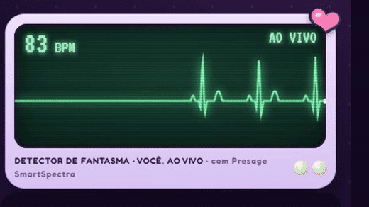

*This is a submission for the [Presage SmartSpectra SDK Challenge](https://dev.to/devteam/join-the-presage-smartspectra-sdk-challenge-3000-in-prizes-across-10-winners-1370).*

Marina had her bag on her shoulder and her keys in her hand. At the door, a feeling hit her so hard she couldn't breathe. *Stay.* She lives alone, and she saw nothing.

But the hallway camera was on. And on second 8 of that tape, behind her on the dark stairs, there is a second face.

Its pulse reads **0 beats per minute**.

**▶ [Play it now in your browser](https://jenniferevangelista-de.github.io/who-else-was-there/)**: no install, no account. Then let the detector read *you*, live.

*A real, live reading through the Presage SDK. The camera image is hidden in the recording on purpose: only the numbers leave the screen.*

## What I Built

Most camera-vitals apps measure the pulse that is there. **Ghost Hunt** is a cute, spooky game that hunts for the pulse that is **missing**.

The idea is simple. Living faces have a heartbeat, and Presage SmartSpectra can read it from a plain webcam. So the scariest thing a camera can find is a face that doesn't have one.

You play with three tiny ghost hunters. **Luna** believes everything. **Dr. Bigotes** believes nothing and refuses to sign a verdict he can't measure. **Xochi** writes it all down. Together you:

1. **Open Marina's case.** Thirty nights of hallway tape, one pulse per night, and something getting closer.
2. **Point the detector** at the dark stairs. It finds the second face by itself and locks on. 0 BPM. It never breathed.
3. **Ask the spirit** on a board where the glass moves only when **you breathe out**, and waits whenever you talk.
4. **Get read yourself.** In *The Room*, your real pulse, breathing and blinks drive the game. If your pulse jumps right after the glass stops, the lights go out.
5. **Bring your own tape.** Upload a video (only after you confirm everyone in it agreed), and get a report with a verdict: *was anyone else there?*

| Point | Ask | Report |
| --- | --- | --- |
|  |  |  |

Marina's story is drawn, and every screen of it is tagged *sample data*. The Room and uploaded videos are real SDK readings.

## Demo

**Demo, with the live signal:**



**Pitch:**



**Play it in your browser, no install:** https://jenniferevangelista-de.github.io/who-else-was-there/ (sample numbers, tagged). The live camera reading runs in the desktop app, because the Presage SDK is native (Node.js/Electron). No login is needed.

## Code



Setup is in the README. The whole SDK integration lives in one file: `app/renderer/presage.js` (`@smartspectra/node-sdk` 3.4.0).

## How It Responds to Human Signals

Seven live SmartSpectra signals, and each one has a job in the game:

| Signal | What it does in the game |
| --- | --- |
| **Pulse** (`cardio.pulseRate`) | Drives the heart and the detector line in real time. A face with no pulse is the case. |
| **Chest movement** (`breathing.upperTrace`) | Moves the séance glass when you breathe out. Catches a held breath. |
| **Talking** (`face.talking`) | Makes the glass wait while you speak. |
| **Blinks** (`face.blinking`) | The only thing that moves the figure in The Room. Blink, and it's closer. |
| **Breathing rate** (`breathing.rate`) | Becomes an evidence card. |
| **Expression** (`face.expression`) | Becomes an evidence card. |
| **Validation status** (`validationStatus`) | Turns "multiple faces" into *a second face*, and poor light into *unreadable*. |

One rule keeps the spirit honest: **cite or vanish**. There is no language model. Every line the spirit says must cite a measured card, and every number in it must match that card, or the line is never said.

### The surprise: a good ghost detector is mostly a skeptic

The computer vision belongs to Presage, and I treat it as an instrument. What is mine is the logic that decides what the numbers mean, so I tested that the way you'd test a ghost detector: **I hid fake ghosts in 19,000 synthetic tapes** where I already knew the answer (`npm run benchmark`).

The result that surprised me was not finding ghosts. It was **not inventing them**:

- A living face was called a ghost **0 times in 400**.
- Across the full verdict test, **1,000 right answers out of 1,000**.
- Then I pushed the noise up until it broke. From **9 BPM of jitter**, the alarm starts going off by itself. That's where it breaks, and the README shows the chart.

What made the difference was listening to the SDK's own doubt:

1. **Confidence is part of the signal.** A pulse under 50% confidence doesn't count. Without that rule, a shaky reading looks exactly like a ghost.
2. **Bad light is not a spirit.** When validation status says a face can't be read, the game says *unreadable*, never *ghost*. Dr. Bigotes refuses to sign.
3. **The SDK wants a real device.** A cloud server (GitHub Actions) was refused pairing (HTTP 403), so every live reading in the demo comes from a real computer with a webcam.

## Prize Categories

**Most Creative or Delightful Use.**

- **What inspired it:** in a Pew Research Center survey, **18% of U.S. adults** said they had seen or been in the presence of a ghost ([Pew](https://www.pewresearch.org/short-reads/2015/10/30/18-of-americans-say-theyve-seen-a-ghost/)). I wanted to give that feeling an instrument, and a rule: nothing counts unless the camera measured it.
- **What makes it unexpected:** the clue is a heartbeat that never comes. Your own breath moves the glass. A blink is a jump scare with rules. And the skeptic in the crew wins every argument the numbers can't settle.
- **Who it's for:** friends at a party or on a stream, in English or Portuguese. One click opens the web demo.
- **Delight with care:** the scare never becomes a health claim. Bad light says *unreadable*, never *ghost*.

## Consent and Data Handling

- **Camera consent:** a rules screen comes first. The camera turns on only when you press a button, a pill at the top right turns it off at any time, and the microphone is never requested.
- **Other people's videos:** the file picker stays locked until you confirm that everyone in the recording agreed.
- **Storage and retention:** no frames saved and no video recorded. Readings live in memory and vanish when the app closes. A report is written only if you press Save, with numbers and words only.
- **Sharing:** the app has no server of its own and sends nothing to one.
- **The SDK:** frames are handed to Presage SmartSpectra inside the app, using your API key and Presage's authenticated channel. Presage's public documentation doesn't say where frames are processed, so I don't claim on-device processing. See Presage's Telemetry and Privacy page and Privacy Policy.
- **SDK telemetry:** switched off (`enableTelemetry: false`).
- **Deletion:** close the app and the readings are gone. Delete a saved report like any file.
- **AI services:** none at run time.
- **Not medical:** this is a game. It doesn't diagnose, treat or monitor anyone.

## Credits

- Presage SmartSpectra (`@smartspectra/node-sdk` 3.4.0), used under Presage's terms.
- Luna, Dr. Bigotes and Xochi come from my earlier project [Witching Hour](https://github.com/jenniferevangelista-de/witching-hour).
- Fonts: Fredoka, Cormorant Garamond and VT323 (SIL Open Font License). Music and voices are original.

Built with AI coding assistance. The story, design decisions and testing direction are mine.
